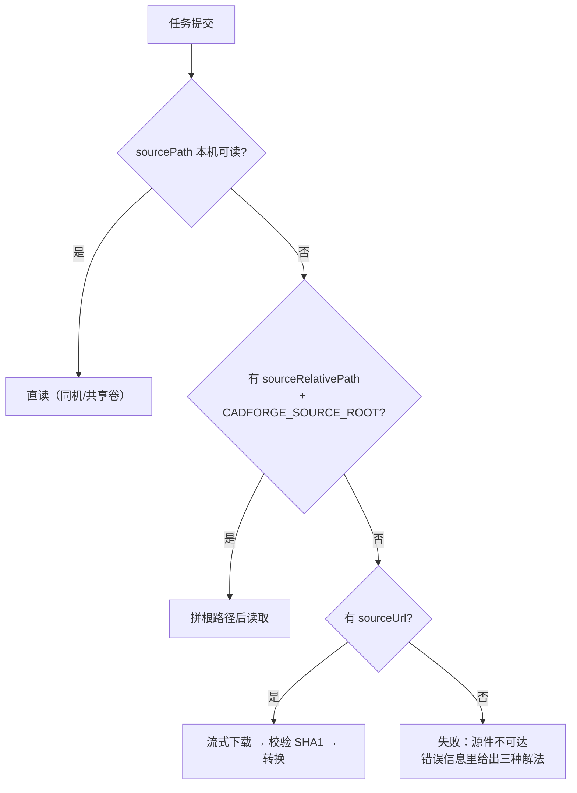

# CK-CADForge

CAD 轻量化转换服务：把 STEP 数模转成浏览器可直接渲染的轻量化资产（多种格式，默认 GLB + 装配结构树）。

它是 CK-PLM 的生态项目，但**必须独立部署**——不是架构洁癖，是许可证边界。

> 完整的部署清单（Docker / 裸机 / 与 CK-PLM 对接 / 验收步骤 / 故障排查）见 CK-PLM 仓库的
> [`docs/CK-CADForge-安装指南.md`](../CK-PLM/docs/CK-CADForge-安装指南.md)；
> 本文只写这个仓库自身的运行与开发要点。

---

## 转换链路的定位：本服务只做后半段

考虑到企业在转换器上的投入（商业 CAD 内核授权按年付费、且与本项目的开源定位冲突），
我们选择的是一条**开源、可自主可控**的链路：

```
CAD 源文件 ──① 调用各 CAD 的 API（未来在 CAD 集成中实现）──> STEP / STP ──② 本服务 ──> 轻量化表达
                                                                              └── 多种格式，默认 GLB
```

| 段 | 做什么 | 谁负责 | 状态 |
|---|---|---|---|
| ① CAD 源文件 → STEP/STP | 调用各 CAD 原生 API 导出中性格式 | CAD 集成（另一条线） | 未来实现 |
| ② STEP/STP → 轻量化表达 | 读入装配层级/颜色/名称，网格化，输出轻量化资产 | **本服务** | 已实现（默认 GLB） |

**输入端统一为 STEP 是本服务能只维护一个内核（OCCT）的前提**：每多支持一种 CAD 原生格式，
就多一份格式适配与回归成本，而把这件事收敛到"CAD 自己导出 STEP"上，
等于让各 CAD 厂商的官方 API 替我们承担兼容性工作——这也正是 STEP 作为中性格式存在的意义。

输出侧的多种格式见 [输出格式（`options.targetFormat`）](#输出格式optionstargetformat)，当前默认 GLB。

---

## 为什么必须独立

| 项目 | 许可证 |
|---|---|
| CK-PLM | Apache-2.0 |
| pythonocc-core | **LGPL-3.0** |
| OCCT（底层内核） | LGPL-2.1 + OCCT Exception |

Apache-2.0 与 LGPL-3.0 不兼容。独立进程 + HTTP 协作不触发 copyleft 传染；
一旦把本项目代码或产物打进 CK-PLM 的镜像，许可证边界就模糊了。

而"许可证干净"正是开源 PLM 能让企业放心用的前提——这个边界值得守住。

顺带还有三条工程理由：

1. **体积**：OCCT 原生库会让镜像从 ~250MB 膨胀到 2GB+，不该让不需要 3D 预览的部署买单；
2. **故障域**：OCCT 遇到畸形 STEP 会**直接段错误**，Python 的 try/except 完全接不住，必须进程隔离；
3. **伸缩**：转换是 CPU 密集 + 内存峰值高，Worker 要能独立扩。

---

## 快速开始（先确认服务活着）

OCCT 要装 conda 包（几百 MB）。先用最小依赖把服务跑起来：

```bash
pip install -r requirements.txt
export CADFORGE_OUTPUT_DIR=/tmp/cadforge
python -m uvicorn app.main:app --port 8090
curl http://localhost:8090/healthz      # engine=mock 说明当前解释器没有 OCCT
```

**演示管线默认关闭**：没有 OCCT（或源文件不在本机）时，提交任务会直接失败并写清原因，
不会产出与源文件无关的模型。只有本地联调前端时才临时放行：

```bash
export CADFORGE_ALLOW_MOCK=1
```

放行后提交一个任务：

```bash
curl -X POST http://localhost:8090/api/v1/jobs \
  -H 'Content-Type: application/json' \
  -d '{"externalId":"demo-1","sourceFileName":"demo.step","callbackUrl":""}'
```

返回 `{"jobId":"...","status":"QUEUED","accepted":true}`，稍后查询：

```bash
curl http://localhost:8090/api/v1/jobs/{jobId}
```

演示管线会产出一个**程序生成的演示装配体**（底板 / 端盖 / 四颗螺栓 / 主轴），
产物结构与真实管线完全一致，前端不需要任何特殊处理 —— 但它与源文件无关，
所以**生产环境禁止开启**（过去正是它让"转换成功"掩盖了"起错解释器"）。

---

## 启用真实转换内核

```bash
conda create -n cadforge python=3.10
conda activate cadforge
conda install -c conda-forge pythonocc-core=7.7.2   # 固定小版本：SWIG 绑定的行为差异是静默的
pip install -r requirements.txt
```

已在 **pythonocc-core 7.7.2 / OCCT 7.7.2** 上实测跑通完整管线。
Windows 下注意：OCCT 的 DLL 在环境的 `Library\bin` 里，
必须激活 conda 环境（或把它加入 `PATH`）再启动服务，
否则几何调用会因找不到 DLL 而崩溃。

`pythonocc-core` 不能用 pip 装（依赖 OCCT 原生库，官方只发 conda 包）。
装好后服务自动切换到真实管线，`GET /healthz` 的 `engine` 字段会变成 `occt`。

可选：装 `gltfpack`（meshoptimizer）启用几何压缩：

```bash
npm install -g gltfpack
```

> **注意 `-kn -km` 必须带。** gltfpack 默认会把 node name 清掉来压体积，
> 但那些 name 是结构树与三维模型联动的唯一锚点，清了前端就再也对应不上。

---

## 与 CK-PLM 对接

### 首选：在 CK-PLM 页面上配（改完立即生效）

**业务配置 → 轻量化转换 → 页签「轻量化转换服务配置」**（平台管理员）：

| 字段 | 填什么 |
|---|---|
| 转换器地址 | `http://cadforge:8090`（跨机填实际地址） |
| 结果回调地址 | `http://backend:8082/api/internal/cad/convert/callback`（填转换器能访问到的服务名） |
| 服务间回调令牌 | 与本服务的 `CADFORGE_CALLBACK_TOKEN` **完全一致** |

这些值存在 CK-PLM 的 `ck_cad_forge_config`（单行表），保存后后端刷新运行时快照并重建
HTTP 客户端，**不需要重启**。页面上点「测试连接」能看到本服务 `/healthz` 自报的
`engine` / `maxConcurrency` / `lanes` —— `engine=mock` 就是解释器没装 OCCT。

### 备选：写在 yml 里（首次启动的种子 + 兜底）

```yaml
plm:
  cad:
    forge:
      enabled: true
      base-url: http://cadforge:8090
      callback-token: <共享令牌>
      callback-url: http://ck-plm-backend:8082/api/internal/cad/convert/callback
  integration:
    # 转换器在内网/回环地址时：OutboundUrlGuard 默认拦私网地址（防 SSRF），需显式放行。
    # 优先逐条登记（主机:端口），allow-private-hosts 是"整台服务器可信"时才用的粗粒度开关
    allowed-hosts: [ "cadforge:8090" ]
    # allow-private-hosts: true
```

> 库里有 `ck_cad_forge_config` 那一行时**以库为准**，yml 只在首次启动时播种、在库不可用时兜底。

### 本服务侧

```bash
export CADFORGE_CALLBACK_TOKEN=<同一个共享令牌>
export CADFORGE_OUTPUT_DIR=/data/ck-plm/cad/visualizations   # 产物目录（不必与 CK-PLM 共享）
# 跨机且无共享存储时：配源件地址白名单（防本服务被当跳板）
# export CADFORGE_SOURCE_ALLOWED_HOSTS=ck-plm:8082
```

**源文件怎么到转换器手上，有三条路**（详见 [取源：三种部署形态](#取源三种部署形态)）：
同机/共享卷直读、相对路径 + 根目录、**带签名 URL 下载**。
中小企业大多没有共享存储，后两条就是为这种情况准备的 —— **共享存储不是使用前提**。

**产物回传不依赖共享卷**：CK-PLM 读不到绝对路径时，会通过 `/artifacts/{kind}` 下载（CK-PLM 侧自动兜底）；
共享卷只是"能挂就更快"的加分项，不是必需项。

**8090 不要对外暴露**：`/api/v1/jobs` 没有入站鉴权（令牌只用于回调时证明身份），
谁能访问 8090 谁就能提交任务，也就**能让本服务去拉任意 URL**。跨机部署用防火墙只放行 CK-PLM 后端。

---

## 取源：三种部署形态

`sourcePath` 是 CK-PLM 视角的路径，但部署形态不同，"本服务能不能读到它"差别很大。
所以取源按下面三条路依次尝试，第一条成立就用，全不通才失败：

| 优先级 | 条件 | 适用场景 | 需要什么 |
|---|---|---|---|
| 1 | `sourcePath` 本机可读 | **同机部署**，或共享卷且两边挂载路径一致 | 无额外配置 |
| 2 | `sourceRelativePath` + `CADFORGE_SOURCE_ROOT` | 有共享存储，但**两边挂载点不同** | 本服务配根目录，CK-PLM 传相对路径 |
| 3 | `sourceUrl`（带签名） | **跨机且完全没有共享存储** | CK-PLM 提供内部下载接口 |



第 3 条的几个实现细节，都是踩过或能预判的坑：

- **流式写盘**（1MB 分块），几百 MB 的 STEP 绝不整读进内存；
- **SHA1 校验**用请求里已有的 `sourceSha1`：传一半的文件交给 OCCT，症状是"转换器莫名崩溃"，
  很难联想到是下载断在半路；
- **下载超时独立于转换超时**（`CADFORGE_SOURCE_TIMEOUT`）：慢网络不该被判成"转换超时"，
  这是两种完全不同的故障，排查方向也完全不同；
- **下载在拿到车道槽位之后才开始**：否则排队任务一起下载，磁盘和带宽同时打满；
- **用完即删**：转换成功后删除下载的源件（失败时保留原件用于排查，可用 `CADFORGE_KEEP_SOURCE=1` 全留）；
- **白名单**：见下方 `CADFORGE_SOURCE_ALLOWED_HOSTS`，别让这里变成探内网的跳板。

CK-PLM 侧需要的配合（第 3 条）：提交任务时带 `sourceUrl`，指向一个**内部、带短期签名**的下载接口；
本服务拉取时会带上 `X-Cad-Forge-Token`（与回调同一把令牌），不引入第二套凭据。

---

## API

| 方法 | 路径 | 说明 |
|---|---|---|
| POST | `/api/v1/jobs` | 提交任务（立即返回，异步执行） |
| GET | `/api/v1/jobs/{jobId}` | 查状态（CK-PLM 看门狗的补偿通道） |
| DELETE | `/api/v1/jobs/{jobId}` | 取消在途任务，释放 Worker |
| GET | `/api/v1/jobs/{jobId}/artifacts/{kind}` | 下载产物（kind: `glb` / `structure` / `thumbnail`） |
| GET | `/healthz` | 健康检查：内核（`occt`/`mock`）、并发与车道配额、在跑/排队数 |

### 环境变量

| 变量 | 默认 | 说明 |
|---|---|---|
| `CADFORGE_OUTPUT_DIR` | `/data/ck-plm/cad/visualizations` | 产物目录，建议指向与 CK-PLM 的共享卷；每个任务一个子目录 `<jobId>/` |
| `CADFORGE_CALLBACK_TOKEN` | 空 | 回调 CK-PLM 的服务间令牌（`X-Cad-Forge-Token`）。为空时回调不带令牌，CK-PLM 一律拒绝 |
| `CADFORGE_JOB_TIMEOUT` | `300` | 单任务硬超时（秒），超时 kill 整棵子进程树 |
| `CADFORGE_MAX_CONCURRENCY` | `max(2, min(6, 核数/2))` | 并发转换上限，超出的排队。**镜像里被固化成 2**，部署时按核数覆盖 |
| `CADFORGE_HEAVY_CONCURRENCY` | `1` | 慢车道槽位（大件）；快车道 = 总并发 − 它 |
| `CADFORGE_HEAVY_SIZE_MB` | `20` | 源文件 ≥ 此值（MB）走慢车道 |
| `CADFORGE_CALLBACK_TIMEOUT` | `10` | 回调 HTTP 超时（秒） |
| `CADFORGE_SOURCE_ROOT` | 空 | 源件根目录，与 CK-PLM 传的 `sourceRelativePath` 拼接。**两边挂载点不同**时用（取源第 2 条路） |
| `CADFORGE_SOURCE_TIMEOUT` | `300` | 源件下载超时（秒）。与 `CADFORGE_JOB_TIMEOUT` 分开：后者只管转换，慢网络不该被判成"转换超时" |
| `CADFORGE_SOURCE_TOKEN` | 同 `CADFORGE_CALLBACK_TOKEN` | 拉源件时带的令牌（`X-Cad-Forge-Token`）。缺省复用回调令牌，不引入第二套凭据 |
| `CADFORGE_SOURCE_ALLOWED_HOSTS` | 空（不校验） | 源件地址白名单（`host` 或 `host:port`，逗号分隔）。**跨机部署强烈建议配置** —— 8090 无入站鉴权，不设防这里就是探内网的跳板 |
| `CADFORGE_KEEP_SOURCE` | 空（成功即删） | 置 1 时转换成功后也保留下载的源件。失败时无论如何都保留（排查必须有原件） |
| `CADFORGE_PROGRESS_INTERVAL` | `1.0` | 过程进度上报最小间隔（秒），避免大装配刷出上百次回调 |
| `CADFORGE_LOG_TAIL` | `2000` | 子进程输出保留行数 |
| `CADFORGE_ALLOW_MOCK` | 空（禁用） | 允许降级到演示几何。默认禁用：没有 OCCT 或源文件不在本机时任务直接失败，而不是产出与源文件无关的演示模型 |
| `PORT` | `8090` | 仅 `python -m app.main` 启动方式使用 |

请求体：

```json
{
  "externalId": "CK-PLM 侧记录 oid",
  "sourcePath": "/data/ck-plm/cad/xxx.step",
  "sourceRelativePath": "cad/2024/06/xxx.step",
  "sourceUrl": "https://ck-plm:8082/api/internal/cad/source/xxx?sig=...",
  "sourceFileName": "gear-box.step",
  "sourceSha1": "...",
  "callbackUrl": "http://ck-plm:8082/api/internal/cad/convert/callback",
  "options": { "targetFormat": "glb", "generateStructure": true }
}
```

`sourcePath` / `sourceRelativePath` / `sourceUrl` **三选一即可**，按
[取源：三种部署形态](#取源三种部署形态) 的优先级解析；`sourceSha1` 用于校验下载完整性。

### 输出格式（`options.targetFormat`）

| 值 | 状态 | 产物 | 说明 |
|---|---|---|---|
| `glb` | **已支持（默认）** | `model.glb` | 二进制 glTF 2.0。浏览器直渲，含装配层级、颜色与结构树联动锚点 |
| `gltf` | 规划 | `.gltf` + `.bin` | 文本 glTF，便于版本 diff 与工具链调试 |
| `stl` | 规划 | `.stl` | 3D 打印 / CAM 下游。无颜色、无层级，按 mm 输出 |
| `obj` | 规划 | `.obj` + `.mtl` | 供 Blender / Unity / 3dsMax 再加工 |
| `draco-glb` | 规划 | `model.glb` | Draco 压缩 GLB，体积更小；前端需 `DRACOLoader`，几何有量化损失 |

规则：

- **省略该参数即默认 `glb`** —— 不传的行为与现在完全一致，已有调用方无需改动。
- **当前版本只实现了 `glb`。** 传入表中其他值**不会静默降级**：提交时直接 `400`，
  任务也不会返回一个与请求格式不符的产物。这与演示管线的处理原则一致 ——
  宁可失败并说清原因，也不产出"看着成功了但其实不对"的东西
  （过去正是"转换成功"掩盖了"起错解释器"）。
- 新增格式改一处常量 + 一个写出器：`app/pipeline.py` 的 `SUPPORTED_TARGET_FORMATS`
  （唯一事实源），写出器计划统一收在 `app/formats.py`；改完同步这张表。
- 多格式导出（一次任务同时产 glb + stl）暂不支持：`targetFormat` 是单值，不是数组。
- `options.generateStructure` 同样是**预留字段**：结构树恒随 GLB 一起产出，传 `false` 不会跳过。

> 产物 `kind` 目前只有 `glb` / `structure` / `thumbnail` 三种（见上方 API 表）。
> 将来新增格式会以同名 `kind` 出现在 `artifacts` 里，CK-PLM 侧按 `kind` 取用即可。

---

## 子进程隔离

OCCT 遇到畸形 STEP 会**直接段错误**（Windows 上退出码 `3221226505` = 0xC0000409）。
这发生在 C 层，Python 的 `try/except` 完全接不住——线程隔离也没用，
一次崩溃会带走整个服务，所有在途任务一起失败。

所以每个任务都 fork 一个独立子进程（`app/worker.py`）：

- 硬超时后 kill 整棵进程树（Windows `taskkill /F /T`，POSIX `killpg`）
- 崩溃退出码归一成 `FAILED`，并给出可诊断的错误信息
- 结果经 JSON 文件回传（不用 stdout pipe——子进程刷屏会堵死管道）
- 并发上限 `CADFORGE_MAX_CONCURRENCY`，超出的排队

已实测：提交必崩任务后，服务存活、后续任务照常成功（见 `tests/e2e_service.py`）。

---

## 并发与分道

一个 200 MB 的整机装配会把 Worker 占满几分钟，后面排队的 50 个零件图只能干等。
所以按源文件大小分两条车道（`sourceSize` 由 CK-PLM 提交时带上）：

| 车道 | 槽位 | 准入 | 说明 |
|---|---|---|---|
| fast | `max(1, MAX_CONCURRENCY − HEAVY)` | < `CADFORGE_HEAVY_SIZE_MB` | 零件图走这里，永远留着槽位 |
| heavy | `CADFORGE_HEAVY_CONCURRENCY`（默认 1） | ≥ 阈值（默认 20 MB） | 大装配独占，不挤占快车道 |

- 默认总并发 = `max(2, min(6, 核数/2))`：下限 2 保证"一边转、一边还能响应"；
  上限 6 是因为每个 OCCT 子进程峰值 1~3 GB，再往上不是更快而是换页
  （31 MB 装配体实测单进程约 1.4 GB）。
- `HEAVY_CONCURRENCY` 必须**小于** `MAX_CONCURRENCY`，否则快车道会被压到只剩 1 个槽。
- 并发在进程启动时算一次，改完要重启；生效值直接看 `/healthz` 的
  `maxConcurrency` 与 `lanes`（正常配置下 `fast + heavy` 等于总数）。
- 池大小（`main.py`）与槽位数（`worker.py`）取同一组常量，
  不会出现"池里能跑 3 个、槽位只放 1 个"的假并发。

---

## 测试

```bash
python tests/make_sample_step.py      # 生成真实 STEP 测试件（含两级装配 + 4 次零件引用）
python tests/e2e_real.py              # 真实内核管线：产物 + 锚点 + 单位校验
python tests/e2e_service.py           # 服务级：异步、崩溃隔离、崩溃后可用性
```

`e2e_real.py` 校验的不是"生成了文件"，而是**联动锚点是否成立**——
每个结构树 id 都能在 glTF 里找到同名 node。这个锚点断了，
前端点结构树就选不中模型：最容易悄悄坏掉，也最难发现。

---

## 实测校准记录（pythonocc-core 7.7.2 / OCCT 7.7.2）

这套 SWIG 绑定有几个会让人卡半天的坑，都是实测出来的：

| 调用 | 结论 |
|---|---|
| `TDocStd_Document(...)` | **必须传 `str`**；传 `TCollection_ExtendedString` 直接崩溃（0xC0000409） |
| `RWGltf_CafWriter(...)` | 同上，**传 `str`**，传 `TCollection_AsciiString` 崩溃 |
| `RWMesh_CoordinateSystemConverter` | **必须同时设 `SetInputLengthUnit` 和 `SetOutputLengthUnit`**；只设前者时 `IsEmpty()` 仍为 true，OCCT 静默放弃整个变换，模型会大 1000 倍 |
| `BRepBndLib` | 用 `brepbndlib_Add(shape, box)` 两参数形式 |
| 网格化时机 | 必须在 `writer.Perform` 之前，否则 OCCT 跳过无三角化数据的节点 |
| `TDataStd_Name` 读取 | **不可用**：`FindAttribute` 返回 true（名字确实在），但 `Handle.DownCast` 抛异常，拿不到值 |

最后一条直接决定了架构：**结构树从生成的 glTF 反推，而不是遍历 XCAF**。
glTF 里天然带 node 层级、name 和 material 颜色，与三维模型天然对齐，
不需要猜测遍历顺序是否一致，也绕开了这套坏的 Handle 绑定。

---

## 已知限制

- **零件名常常拿不到**：OCCT 7.7.2 只把 product name 给到 assembly 节点，
  part 节点给的是 label entry（形如 `=>[0:1:1:3]`）。转换器已识别并替换成可读默认名，
  `metrics.namedNodeCount` 可观察命名质量，值偏低是内核版本问题而非转换逻辑问题。
- 任务状态存在内存里（生产请换 Redis，转换器本身应保持无状态）。**单实例部署无影响**；
  一旦水平扩展多实例，`GET /jobs/{id}`、`DELETE /jobs/{id}`、`GET /artifacts/{kind}`
  必须打到提交时那个实例，否则 404 —— 要么保持单实例，要么上 Redis，要么网关按 `jobId` 粘性路由
- 并发配额是**每进程**的：N 个实例的全局并发 = N × `CADFORGE_MAX_CONCURRENCY`，规划容量别按单实例算
- 源件下载占用车道槽位（下载完才开始转换），大文件在慢网络上会拉长槽位占用时间
- gltfpack 未内置镜像，装了才启用压缩（压缩后会自动校验锚点是否存活）
- 尚未实现 PMI / 材料属性 / 质量属性抽取（P2）
- **只支持 GLB 输出**：`options.targetFormat` 的其余取值（`gltf` / `stl` / `obj` / `draco-glb`）
  已列入规划但未实现，传入会直接失败而非降级；也不支持一次任务产出多种格式

---

## 许可证

**LGPL-3.0-or-later**（与 pythonocc-core 对齐，避免次级许可证冲突）。

| 文件 | 内容 |
|---|---|
| `LICENSE` | GNU 宽通用公共许可证 第 3 版（LGPL-3.0）全文 |
| `COPYING` | GNU 通用公共许可证 第 3 版（GPL-3.0）全文 —— **LGPL-3.0 是它的补充条款**，两者要一起分发，只放 LGPL 那份不完整 |

每个源文件头部都带 `SPDX-License-Identifier: LGPL-3.0-or-later` 与版权声明 ——
LGPL 要求修改者能看到"这份代码受 LGPL 约束"，尤其当某个文件被单独拷出去时，
仓库根的 LICENSE 就跟不走了。

版权归深圳乘恺科技有限公司（2026~2028）。

独立仓库、独立镜像，不与 CK-PLM 的 Apache-2.0 代码同包分发 —— 原因见开头「为什么必须独立」。
